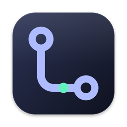
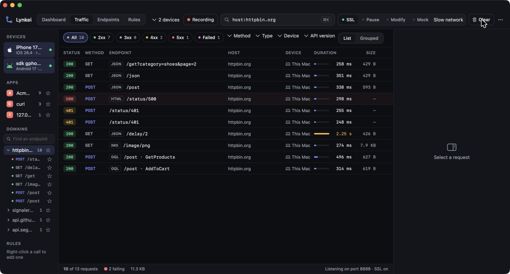
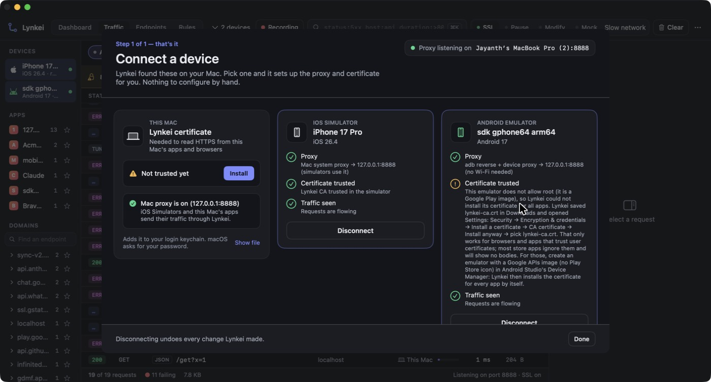
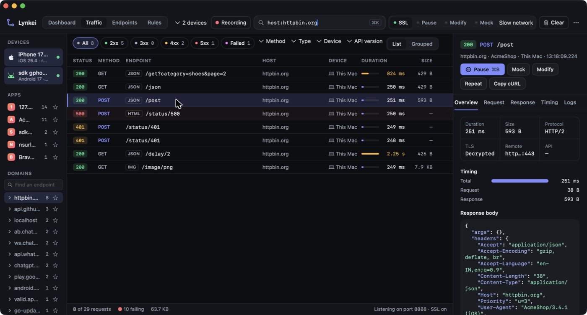
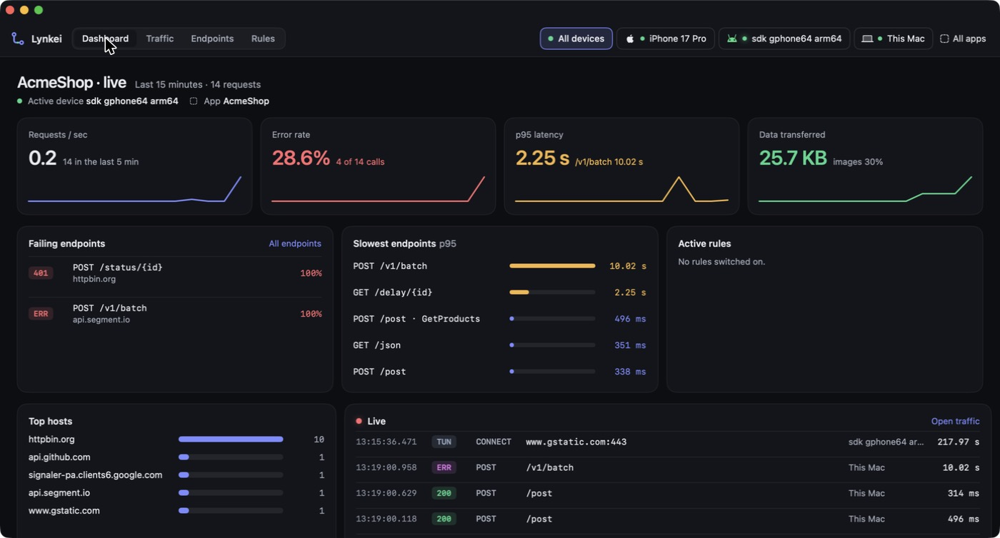
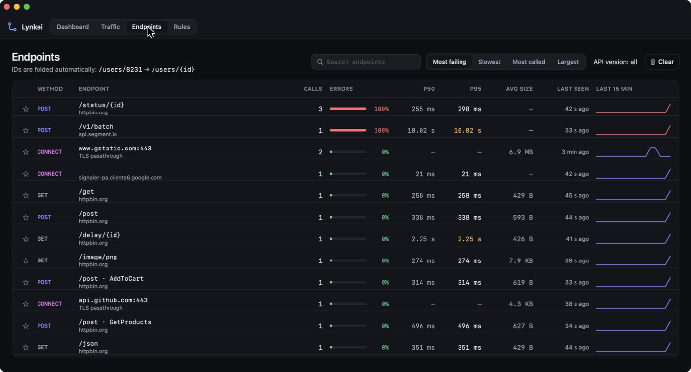
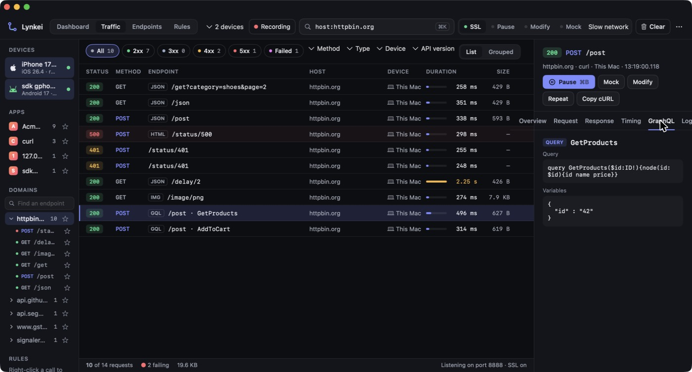
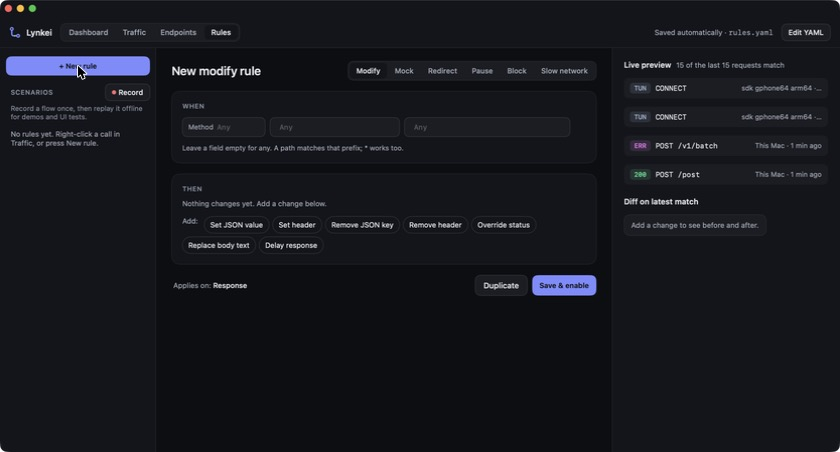
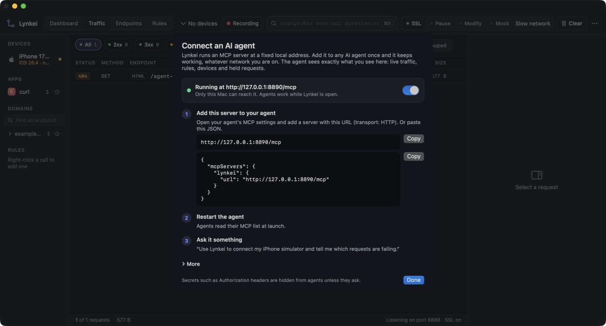

<div align="center">



# Lynkei

**See, change and replay every API call your iOS and Android app makes.**<br/>
An open-source, Charles-class HTTP(S) debugging proxy for mobile developers: native Mac app, Rust engine, built-in MCP server for AI agents.

[](https://github.com/jaintvn/lynkei/releases)


[](LICENSE)

[**Download**](#-download) · [**Features**](#-everything-lynkei-does) · [**Connect an AI agent**](#-connect-an-ai-agent) · [**Quick start**](#-quick-start) · [**Full guide**](docs/GUIDE.md)

<br/>



<sub>Traffic from an iOS Simulator and an Android emulator, captured live. GraphQL operations are split into their own endpoints.</sub>

</div>

---

## ✨ Why Lynkei

|  |  |
|---|---|
| 🔌 **One-click device setup** | Pick a booted iOS Simulator, Android emulator or USB phone. Lynkei sets the proxy *and* installs the certificate, then tells you when traffic arrives. |
| 🔐 **Decrypts HTTPS** | HTTP/1.1, HTTP/2, h2c, WebSockets and TLS interception, with plain-language reasons when an app pins its certificate. |
| 🧰 **Change traffic, don't just watch it** | Breakpoints, mock responses, rewrite rules, DNS spoofing, throttling and more, all from a right-click. |
| 🧠 **Understands your API** | GraphQL operations, gRPC calls (no `.proto` needed) and analytics events (GA4, Segment, Amplitude, Mixpanel, AppsFlyer) are decoded for you. |
| 🤖 **Built for AI agents** | A bundled MCP server lets Claude Code, Cursor or any MCP client connect a device, read traffic and add rules. |
| 🪶 **Native and fast** | A Rust engine under a SwiftUI app. Crash-safe: your Mac's proxy settings are restored even if Lynkei dies. |

---

## 📥 Download

Grab the build for your Mac from the [latest release](https://github.com/jaintvn/lynkei/releases):

| Mac | File |
|---|---|
| Apple Silicon (M1 and later) | `Lynkei-mac-apple-silicon.zip` |
| Intel | `Lynkei-mac-intel.zip` |

> [!NOTE]
> The builds are not notarized yet. If macOS blocks the app, unzip it and run `xattr -dr com.apple.quarantine Lynkei.app`, or use *System Settings → Privacy & Security → Open Anyway*. Downloading with `gh release download` or `curl` avoids the block.

> [!TIP]
> **Zero setup with an AI assistant.** Add the [Lynkei skill](skills/lynkei/SKILL.md) and just ask: *"Set up Lynkei and connect my iPhone simulator."* The assistant downloads the right build for your Mac (after asking you), installs it, adds the MCP server and connects the device. For Claude Code: `mkdir -p ~/.claude/skills && cp -R skills/lynkei ~/.claude/skills/`. More in [Connect an AI agent](#-connect-an-ai-agent).

---

## 🚀 Quick start

1. **Open Lynkei** (or let the [skill](skills/lynkei/SKILL.md) install and open it). It starts a proxy on `127.0.0.1:8888` and creates its own certificate authority.
2. Click **Connect device**. Booted simulators and emulators show up as cards. Press **Connect**.
3. Use your app. Calls appear live, with headers, bodies, timing and the rules that touched them.

<div align="center">

<br/><sub>Each device card ticks off <b>Proxy → Certificate trusted → Traffic seen</b>, and explains anything it can't do (here, an emulator without root).</sub>
</div>

---

## 🔭 Everything Lynkei does

### 📡 Capture and inspect

<div align="center">

</div>

- **Live traffic list** with status, method, type badge, host, device, duration bar and size. Filter by status class, method, content type, device or API version, or group calls by endpoint.
- **Resizable panels.** Drag the sidebar and inspector edges to give long endpoints room; the table adapts its columns as you resize.
- **Inspector** with *Overview, Request, Response, Timing* and *Logs* tabs, a full-size body viewer (pretty JSON, search, edit, field view) and one-click **Copy cURL**.
- **Search language:** `status:5xx host:api path:/v2/* duration:>800ms size:>1MB body:"out of stock" header:x-app-version=3.4 state:failed app:AcmeShop`. Bare words match URLs, headers and bodies. Prefix `-` to negate.
- **Searchable history** stored in SQLite with full-text search, so yesterday's session is still there.
- **App and device attribution:** every call shows the program or device that made it.
- **Favourites** for the endpoints you watch most.
- **HAR import and export** (HAR 1.2), compatible with browsers and Charles.
- **Compose and Repeat:** write a request or resend a captured one, edited, up to 200 times, one by one or all at once. Great for retry and race checks.

### 📊 Dashboard and endpoints

<div align="center">

</div>

- **Dashboard:** requests per second, error rate, p95 latency, data transferred, failing and slowest endpoints, top hosts and a live feed. Scope it to one device or app.
- **Endpoints view:** IDs fold automatically (`/users/8231` → `/users/{id}`). Sort by *most failing, slowest, most called* or *largest*, with p50, p95, average size and a 15-minute sparkline.

<div align="center">

</div>

### 🧬 Understands your protocols

<div align="center">

</div>

- **GraphQL:** every operation becomes its own endpoint (`POST /graphql · GetProducts`), batches are split, persisted queries are recognised, and a *GraphQL* tab shows the query and variables.
- **gRPC:** calls show as `Service/Method` with their status. Messages are decoded **without a `.proto` file**, as JSON keyed by field number.
- **Analytics events:** calls to Google Analytics 4, Segment, Amplitude, Mixpanel and AppsFlyer get an *Events* tab with event names, user and properties.
- **WebSockets:** frames are recorded in both directions.
- **Device logs:** with a simulator or Android device attached, the *Logs* tab shows what the app logged around the call (`simctl log stream` and `adb logcat`).

### 🛠 Change traffic

<div align="center">

</div>

Right-click any call to add a rule, or build one in **Rules**. Everything is a plain `rules.yaml`, so it also works from the CLI and API.

| Rule | What it does |
|---|---|
| ⏸ **Breakpoints** | Hold a matching request and/or response, edit status, headers or body, then *Resume* or *Abort*. A forgotten one is released after 5 minutes. |
| 🎭 **Map local (Mock)** | Answer from a file, or reuse a recorded response. No server needed. |
| 🔀 **Map remote (Redirect)** | Send a host to another, such as staging. |
| ✏️ **Rewrite** | Set or remove headers, edit JSON fields, replace text (plain or regex) or the whole body, change the status, delay the reply. Point-and-click, like Charles' Rewrite. |
| 🌐 **DNS spoofing** | Connect to another address while the app still sees the original host, so certificates and `Host` headers stay intact. |
| 🐢 **Throttle** | 3G, Edge, LTE, lossy LTE, high latency or offline, per rule or globally. |
| ⛔ **Block** | Fail any host or path. |

Each request row shows a badge per rule that touched it, and the inspector lists every rule that fits that endpoint with its on/off switch. A **live preview** shows how many recent requests a rule would match and a before/after diff.

### 🎬 Scenarios

Record a flow once (*Rules → Scenarios → Record*), then **replay it offline** for demos and UI tests. Replays answer from the recording as mock rules, with no server. The same files are used by the MCP server.

### 🤝 Share a session

*File → Share Session…* (⇧⌘S) saves the calls in the list, and optionally your rules, scenarios and nearby logs, into one `.lynkei` file. Authorization, Cookie and API-key headers are hidden by default. A teammate double-clicks the file and sees everything.

### 🏝 The notch island

A small pill hugging the notch (a floating pill on Macs without one) shows request rate, held breakpoints and new failures. Expand it to see the latest calls, connect or disconnect devices, toggle **SSL decrypt**, pick a **throttle** preset or flip whole rule kinds on and off. When a breakpoint holds a call, it opens by itself with **Continue**, **Edit…** and **Abort**. It also warns about **certificate pinning**, **failure spikes** and **disconnected devices**.

### 🔒 Certificates, made painless

- **Install on this Mac** from the Connect screen (adds Lynkei's root to your login keychain), or *Help → Install Lynkei Certificate on This Mac…*.
- **Android over Wi-Fi:** scan a QR code, which opens a page with the certificate and the exact proxy settings. *No cable? Pair with adb* uses Wireless debugging.
- **iPhone over Wi-Fi:** scan a QR code. Wired iPhones are listed too.
- **Plain-language TLS help:** when an app rejects Lynkei's certificate (pinning, or a user CA it ignores), the row says so and the banner explains what to do. Apps that can't be decrypted are tunnelled untouched, so they keep working.
- **Live Mac proxy status:** warns when a VPN or company profile switches your Mac's proxy off, with a button to turn it back on.

---

## 🤖 Connect an AI agent

Lynkei runs an [MCP](https://modelcontextprotocol.io) server inside the app, at a **fixed local address**. Add it to any AI agent once and it keeps working: it is `127.0.0.1`, so Wi-Fi, VPN and IP changes never matter. The agent sees exactly what you see in the app (live traffic, rules, devices, held requests) and can connect a simulator, search and replay calls, add mocks and rewrite rules, and release breakpoints.

<div align="center">

</div>

**1. Add the server to your agent.** Open **Help → Connect AI Agent…**, copy the address, and add it in your agent's MCP settings as an HTTP server. Or paste this:

```json
{ "mcpServers": { "lynkei": { "url": "http://127.0.0.1:8890/mcp" } } }
```

**2. Restart the agent.** Agents read their MCP list when they start.

**3. Ask.**

> *"Use Lynkei to connect my iPhone simulator, then tell me which requests are failing and why."*
> *"Mock `/v2/products` with an empty list and check the app shows its empty state."*
> *"What are the slowest endpoints in the last 10 minutes?"*

**Good to know**
- It starts with the app (switch it off in the same sheet) and only answers requests from this Mac. Web pages in your browser are refused.
- If something else already uses port `8890`, the sheet says so and lets you pick another port; update your agent once.
- Agents work while Lynkei is open. Close the app and they simply can't connect until you reopen it; no reconfiguring.
- An agent that only supports local (stdio) servers can bridge with `npx -y mcp-remote http://127.0.0.1:8890/mcp`.

### 🧠 Add the Lynkei skill (zero setup)

A ready-made agent skill in [`skills/lynkei`](skills/lynkei/SKILL.md) teaches an AI assistant to install Lynkei, add the MCP server, connect a simulator or phone and debug failing calls, so you only say what you want. For Claude Code, copy the folder into your skills directory:

```bash
mkdir -p ~/.claude/skills && cp -R skills/lynkei ~/.claude/skills/
```

Then ask: *"Set up Lynkei and find out why my app's login call fails."*

### What agents get

| | |
|---|---|
| **29 tools** | `status`, `list_devices`, `connect_device`, `set_device_proxy`, `search_traffic`, `get_transaction`, `add_rule`, `toggle_rule`, `send_request`, `repeat_request`, `list_paused`, `resume_paused`, `record_scenario`, `replay_scenario`, `set_throttle`, `set_ssl_decrypt`, … |
| **Resources** | `lynkei://status`, `rules`, `devices`, `paused`, `traffic` (also `lynkei://traffic?query=status:5xx`) |
| **Prompts** | `debug_failing_endpoint`, `mock_api_offline`, `find_slow_calls` |
| **Safe by default** | `Authorization`, cookies and API-key headers are redacted and bodies left out unless the agent explicitly asks for them. |

For CI or a machine without the app, run the headless engine and the same server: `lynkeid &` then `lynkei-mcp --http`, or point an agent at the `lynkei-mcp` binary (stdio); it starts the engine itself. `lynkei-mcp doctor` checks the setup. Details are in the [guide](docs/GUIDE.md#ai-agents-mcp).

---|---|
| **29 tools** | `status`, `list_devices`, `connect_device`, `set_device_proxy`, `search_traffic`, `get_transaction`, `add_rule`, `toggle_rule`, `send_request`, `repeat_request`, `list_paused`, `resume_paused`, `record_scenario`, `replay_scenario`, `set_throttle`, `set_ssl_decrypt`, … |
| **Live resources** | `lynkei://status`, `rules`, `devices`, `paused`, `traffic` (also `lynkei://traffic?query=status:5xx`). Agents can subscribe and are told when a matching call arrives or a request is held. |
| **Prompts** | `debug_failing_endpoint`, `mock_api_offline`, `find_slow_calls` |
| **Safe by default** | `Authorization`, cookies and API-key headers are redacted and bodies left out unless the agent explicitly asks for them. |

Trouble? Run `lynkei-mcp doctor`; it prints the binary, engine and socket it found and starts the engine if needed. Full reference in the [guide](docs/GUIDE.md#ai-agents-mcp).

---

## ⌨️ Command line and daemon

```bash
./target/release/lynkeid                       # proxy on 127.0.0.1:8888 + control API
./target/release/lynkei status
./target/release/lynkei search status:5xx host:api.acme.com 'duration:>800ms'
./target/release/lynkei tail -state:tunneled   # live events
./target/release/lynkei devices connect <id>
./target/release/lynkei throttle 3g
./target/release/lynkei breakpoints wait       # block until a call is held
./target/release/lynkei system-proxy on        # restored on exit or crash
```

---

## 🏗 Architecture

```
core/                    Rust workspace, no platform code
  lynkei-proxy/            Proxy engine: TLS MITM, HTTP/1.1 + HTTP/2, WebSocket, streaming capture
  lynkei-model/            Data model, search language, rules format
  lynkei-store/            SQLite + FTS5 traffic history
  lynkei-control/          Control API (JSON-RPC over a Unix socket), system proxy + crash guard
  lynkei-devices/          Find and connect iOS Simulators, Android emulators and USB phones
  lynkei-ffi/              UniFFI boundary to Swift
  lynkei-mcp/              MCP server for AI agents
  lynkeid/, lynkei-cli/    Daemon and command line
apple/Lynkei/            SwiftUI Mac app
```

A Lynkei app for Android and an iOS companion are planned once there is user feedback.

---

## 🧪 Build from source

Needs Xcode 16+ and Rust via rustup.

```bash
scripts/build-apple.sh && scripts/make-mac-app.sh && open apple/Lynkei/build/Lynkei.app
```

```bash
scripts/make-mac-app.sh release arm64      # Apple Silicon only
scripts/make-mac-app.sh release x86_64     # Intel only (run UNIVERSAL=1 scripts/build-apple.sh first)
scripts/check.sh                           # fmt, clippy, tests and the Apple build, locally
```

**Try it with your own app:** run it in the iOS Simulator or an Android emulator, press **Connect** on the Connect screen and use the app. Calls show up immediately.

---

## 📚 Learn more

- **[Full guide](docs/GUIDE.md):** rule syntax, breakpoints from a terminal, rewrite sheet, search language and the MCP reference.

## 📄 License

Lynkei is licensed under the [Apache License 2.0](LICENSE). Copyright 2026 Jayanth VN.

<div align="center"><sub>Made for people who are tired of guessing what their app sends.</sub></div>
